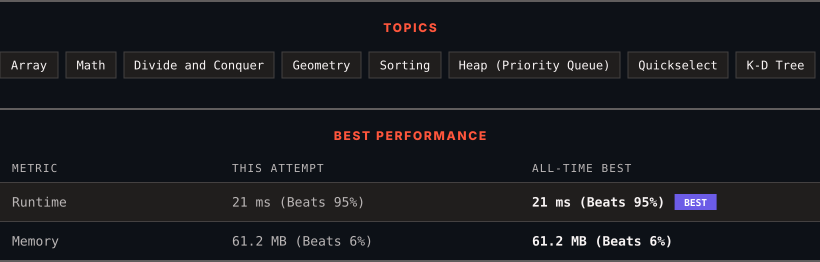

<div align="center">

# 973. K Closest Points to Origin

      

[](https://leetcode.com/problems/k-closest-points-to-origin/)

</div>

---

<div align="center">

<picture>
  <source media="(prefers-color-scheme: dark)" srcset="panel-dark.svg">
  <source media="(prefers-color-scheme: light)" srcset="panel-light.svg">
  
</picture>

</div>

> **New personal best** — Runtime improved on this submission.

### HOW IT WENT

| | |
|:--|:--|
| **Attempts** | first try |
| **Time to solve** | under a minute |
| **Verdicts** | ✅ Accepted |

---

### NOTES

_No notes yet._

---

### SOLUTIONS (1)

| # | File | Language | Date |
|:-:|------|:--------:|:----:|
| 1 | [sol1.java](./sol1.java) | `Java` | 2026-10-12 ← **latest** |

---

### PROBLEM DESCRIPTION

Given an array of `points` where `points[i] = [x_i, y_i]` represents a point on the **X-Y** plane and an integer `k`, return the `k` closest points to the origin `(0, 0)`.

The distance between two points on the **X-Y** plane is the Euclidean distance (i.e., `&radic;(x_1 - x_2)^2 + (y_1 - y_2)^2`).

You may return the answer in **any order**. The answer is **guaranteed** to be **unique** (except for the order that it is in).

 

**Example 1:**


```

**Input:** points = [[1,3],[-2,2]], k = 1
**Output:** [[-2,2]]
**Explanation:**
The distance between (1, 3) and the origin is sqrt(10).
The distance between (-2, 2) and the origin is sqrt(8).
Since sqrt(8) < sqrt(10), (-2, 2) is closer to the origin.
We only want the closest k = 1 points from the origin, so the answer is just [[-2,2]].

```

**Example 2:**

```

**Input:** points = [[3,3],[5,-1],[-2,4]], k = 2
**Output:** [[3,3],[-2,4]]
**Explanation:** The answer [[-2,4],[3,3]] would also be accepted.

```

 

**Constraints:**

	- `1 <= k <= points.length <= 10^4`

	- `-10^4 <= x_i, y_i <= 10^4`

---

<div align="center">

<sub>Auto-synced by <strong>LeetSync</strong> · Built by <a href="https://deveshsamant.in/">Devesh Samant</a></sub>

</div>
